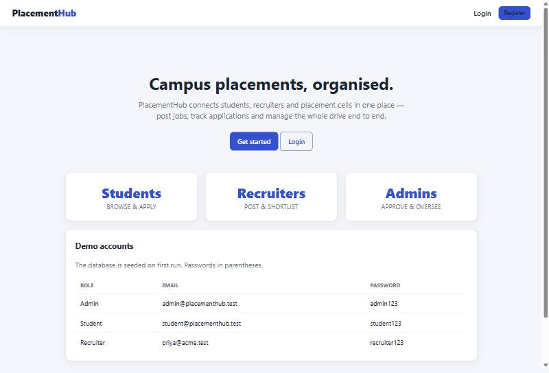
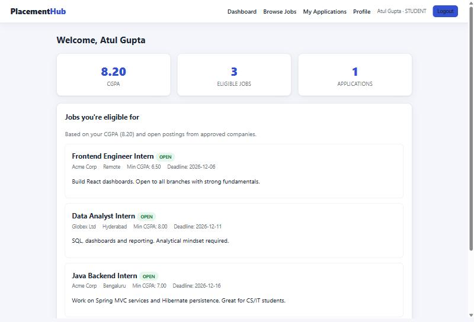
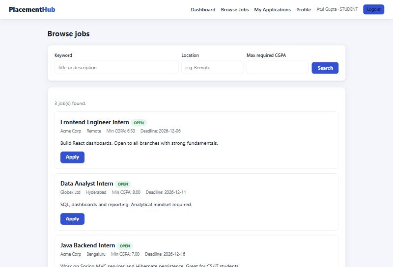
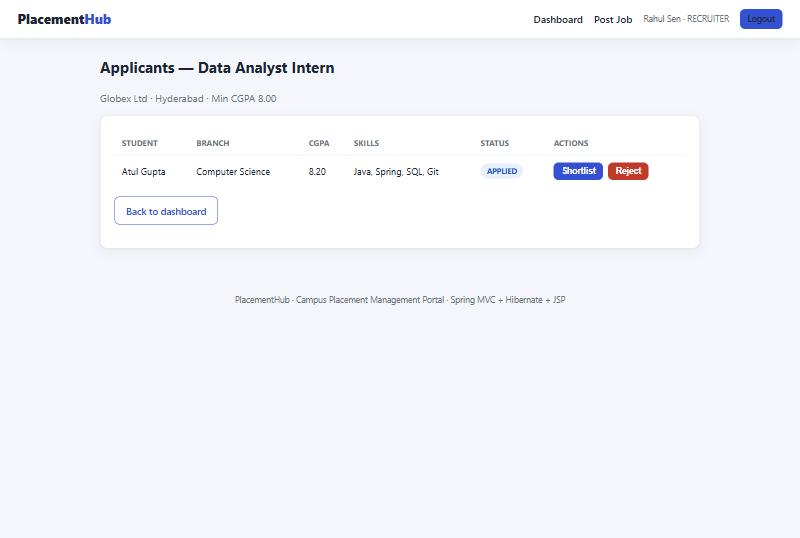
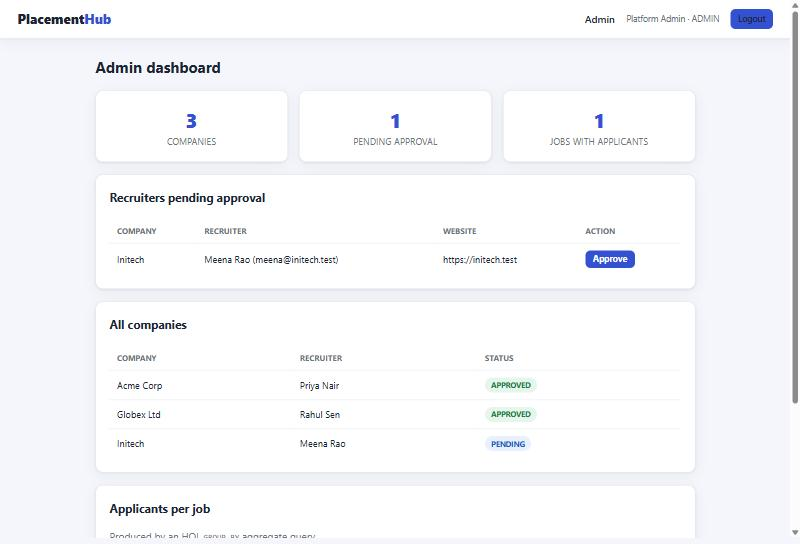
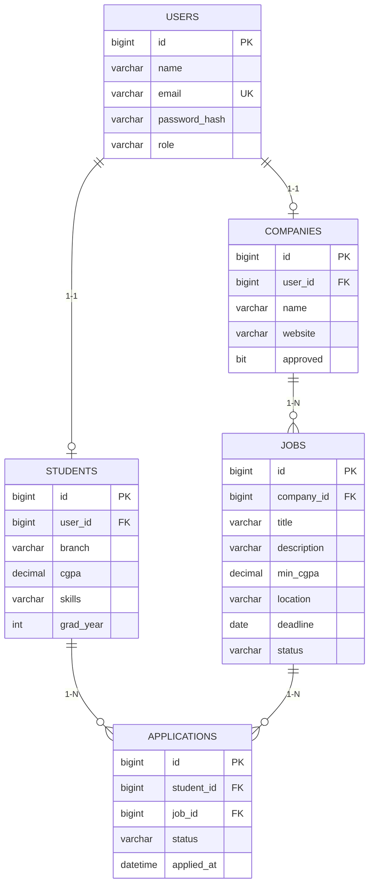

# PlacementHub — Campus Placement Management Portal

A full-stack web application that connects **students**, **recruiters**, and **placement-cell admins** in one place: post jobs, apply, track applications, and manage the whole placement drive end to end.

Built with a classic **Spring MVC + Hibernate + JSP** stack (no Spring Boot) packaged as a **WAR** and deployed on **Apache Tomcat 10**, backed by **MySQL 8**.

---

## Tech stack

| Layer | Technology |
|---|---|
| Language | Java 17 |
| Web / MVC | Spring MVC 6 (DispatcherServlet, Java config — no `web.xml`) |
| ORM | Hibernate 6 (native `SessionFactory`) |
| Views | JSP + JSTL (Jakarta) |
| Database | MySQL 8 |
| Connection pool | HikariCP |
| Validation | Hibernate Validator (Jakarta Bean Validation) |
| Security | BCrypt password hashing (Spring Security Crypto) |
| Build | Maven (WAR packaging) |
| Server | Apache Tomcat 10.1 |
| Tests | JUnit 5 + Mockito |

---

## Screenshots

| | |
|---|---|
| **Landing** |  |
| **Student dashboard** — eligible jobs by CGPA |  |
| **Browse jobs** — search, filter & pagination |  |
| **Recruiter** — view applicants, shortlist/reject/select |  |
| **Admin** — approve recruiters, applicants-per-job (HQL aggregate) |  |

---

## Features

### Roles
| Role | Can do |
|---|---|
| **Student** | Register, log in, edit profile (branch, CGPA, skills, grad year), browse/search jobs, apply, track application status |
| **Recruiter** | Register a company, post/edit/close jobs, view applicants, shortlist / reject / select |
| **Admin** | Approve recruiters, view all companies, see a counts dashboard and applicants-per-job |

### Highlights
- **Layered MVC architecture** — `controller → service → dao → entity`, with JSP/JSTL views.
- **Session-based auth + role-based access control** — `HttpSession` login with a `HandlerInterceptor` guarding `/student/**`, `/recruiter/**`, `/admin/**`.
- **Server-side validation** — Bean Validation (`@NotBlank`, `@Email`, `@DecimalMin`/`@DecimalMax`, …) with `BindingResult` errors rendered in the JSPs.
- **BCrypt** password hashing — plaintext passwords are never stored.
- **Search, filtering & pagination** — jobs filtered by keyword, location and CGPA, paginated with Hibernate `setFirstResult`/`setMaxResults`.
- **HQL queries**, including:
  - *jobs a student is eligible for* by CGPA (`JobDao.findEligibleForStudent`), and
  - *applicants per job* via a `GROUP BY` aggregate (`ApplicationDao.countApplicantsPerJob`).
- **Business rules in the service layer** — eligibility check, duplicate-application prevention, and validated application status transitions (`APPLIED → SHORTLISTED → SELECTED`, or `→ REJECTED`).

---

## Database

Five tables / Hibernate entities with 1-N and N-1 mappings:



The full DDL is in [`schema.sql`](schema.sql). Hibernate can also create the tables automatically (`hibernate.hbm2ddl.auto=update`).

---

## Package structure

```
com.placementhub
├── config        WebConfig, PersistenceConfig, AppInitializer (DispatcherServlet, view resolver, SessionFactory)
├── controller    AuthController, StudentController, RecruiterController, AdminController
├── service       AuthService, StudentService, RecruiterService, AdminService (business rules)
├── dao           Hibernate DAOs using SessionFactory (+ impl package)
├── entity        @Entity classes + enums (User, Student, Company, Job, Application)
├── dto           Form beans, SessionUser, PageResult
└── interceptor   RoleInterceptor (role-based access control)
src/main/webapp/WEB-INF/views/*.jsp   JSTL views
```

---

## Running it locally

### Prerequisites
- JDK 17
- Maven 3.9+
- MySQL 8 running on `localhost:3306`

### 1. Create the database
```sql
CREATE DATABASE placementhub CHARACTER SET utf8mb4 COLLATE utf8mb4_unicode_ci;
```
(Or run the full [`schema.sql`](schema.sql).)

### 2. Configure the connection
Edit `src/main/resources/application.properties` (or set the matching env vars
`DB_URL`, `DB_USER`, `DB_PASSWORD`):
```properties
jdbc.url=jdbc:mysql://localhost:3306/placementhub?useSSL=false&serverTimezone=UTC&allowPublicKeyRetrieval=true
jdbc.username=root
jdbc.password=yourpassword
```

### 3. Build & run
```bash
# run the tests
mvn test

# build the WAR
mvn clean package

# run on an auto-downloaded Tomcat 10.1
mvn cargo:run
```
Then open **http://localhost:8080/**.

> The app can also be deployed by dropping `target/placementhub.war` into any
> Tomcat 10 `webapps/` directory (as `ROOT.war` for the root context).

### Demo accounts
The database is seeded on first run:

| Role | Email | Password |
|---|---|---|
| Admin | `admin@placementhub.test` | `admin123` |
| Student | `student@placementhub.test` | `student123` |
| Recruiter | `priya@acme.test` | `recruiter123` |

---

## Tests

JUnit 5 + Mockito unit tests on the service layer (eligibility, duplicate apply,
status transitions, registration & login):

```bash
mvn test
```

```
Tests run: 18, Failures: 0, Errors: 0, Skipped: 0
```

---

## License

This project was built as a learning / portfolio project. Feel free to use it as a reference.
